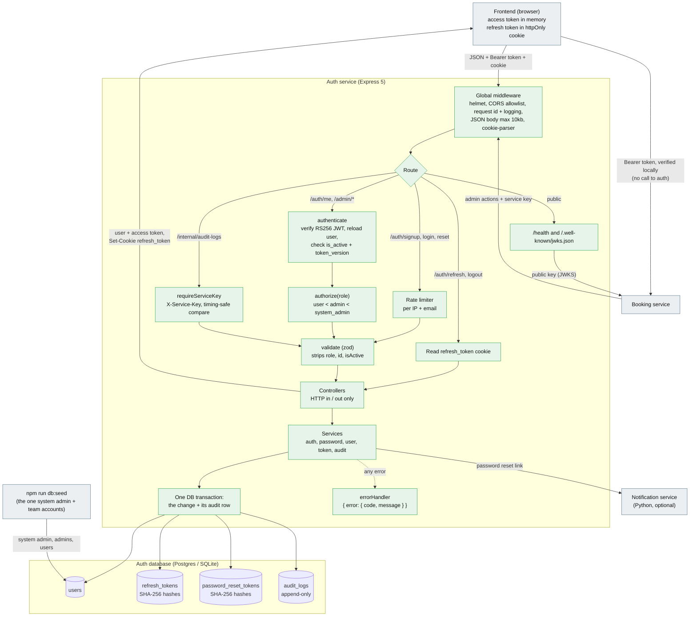
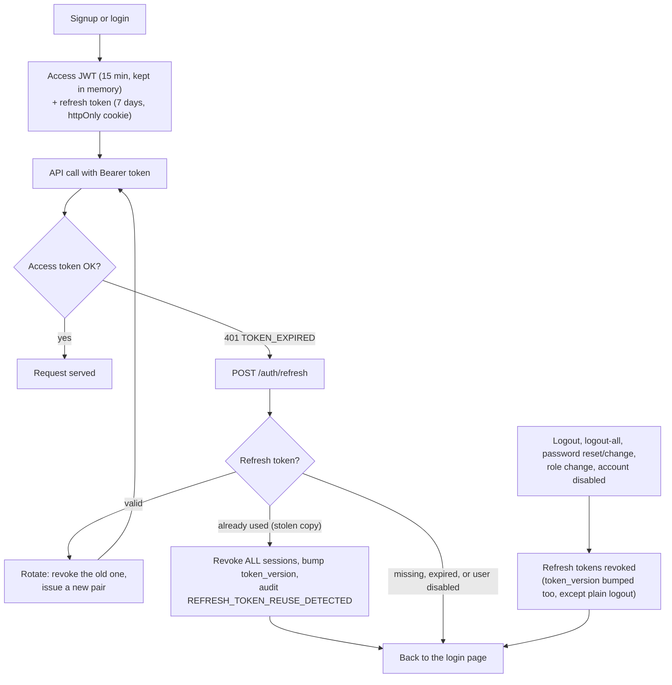

# Auth Service

Signup, login, JWTs and role-based access control (`user`, `admin`, `system_admin`) for the visa appointment platform. It also stores the audit log that the system admin's **Logs** page reads.

Stack: Node 22, Express 5, Sequelize 6 (PostgreSQL, or SQLite for quick local runs), RS256 JWTs.
Full design and the reasoning behind it: [`AUTH_SERVICE_PLAN.md`](../../AUTH_SERVICE_PLAN.md).

---

## Quick start (about 5 minutes)

You need **Node 22+** and one of: **Docker**, a local **PostgreSQL**, or nothing at all (SQLite).

```bash
cd backend/auth-service
npm install
cp .env.example .env              # then set INTERNAL_SERVICE_KEY to a long random string
npm run keys:generate             # writes keys/private.pem + keys/public.pem (gitignored)
```

Pick a database:

| Option | What to do |
|--------|-----------|
| Postgres in Docker | `docker compose up -d postgres` (the default `.env` already points at it) |
| Your own Postgres | `createdb auth_db` and set `DATABASE_URL` in `.env` |
| No database server | In `.env` set `DB_DIALECT=sqlite`. Data goes to `dev.sqlite` |

Then:

```bash
npm run db:migrate     # create the tables
npm run db:seed        # create the team's shared accounts (see below)
npm run dev            # http://localhost:4000
```

Check it works:

```bash
curl localhost:4000/health
# {"status":"ok","db":"ok"}

curl -X POST localhost:4000/auth/login -H 'Content-Type: application/json' \
  -d '{"email":"sysadmin@example.com","password":"Password123"}'
# {"user":{...,"role":"system_admin"},"accessToken":"eyJ..."}
```

### Same accounts for the whole team

This project runs locally, so every teammate has **their own database**. Sequelize doesn't sync data between laptops: it talks to whatever database your `.env` points at. Anything you create through the API (a new admin, a role change) exists only on your machine.

To give everyone the same accounts, they're defined once in the seeder, [`src/db/seeders/20261005000001-team-accounts.js`](src/db/seeders/20261005000001-team-accounts.js). `npm run db:seed` creates them with the **same emails, passwords and user ids** on every machine:

| Email | Role | Password | User id |
|-------|------|----------|---------|
| `sysadmin@example.com` | system_admin | `Password123` | `00000000-0000-4000-8000-000000000001` |
| `admin@example.com` | admin | `Password123` | `00000000-0000-4000-8000-000000000002` |
| `user@example.com` | user | `Password123` | `00000000-0000-4000-8000-000000000003` |

**To add an account the whole team should have:** add a line to `ACCOUNTS` in that file (with a new fixed id) and commit it. Teammates pull and run `npm run db:seed` again. It's safe to re-run: existing accounts are skipped.

The fixed ids matter to the booking service too: an appointment saved for `user@example.com` refers to the same user id on every laptop.

**There is exactly one system admin**, `sysadmin@example.com`, and it comes only from this seed. The database itself refuses a second one (a unique index on the `system_admin` role), and the API can never create, promote to, demote or disable a system admin. There can be any number of regular admins: the system admin creates them with `POST /admin/admins` or promotes users. The seeder refuses to run with `NODE_ENV=production`, since the passwords are public.

**Everything in Docker instead:** after `keys:generate` and creating `.env`, run `docker compose up --build`. Migrations run on startup. Create the team accounts with
`docker compose exec auth-service npm run db:seed`.

**Password reset without an email service:** when `NOTIFICATION_SERVICE_URL` is empty, the reset link is printed in the server log (`[DEV] password reset link for ...`). It is never returned by the API.

---

## How data flows

Every request takes the path below. Green boxes are the auth service, cylinders are its database tables, and grey boxes are the other parts of the platform.



How a session lives and dies:



---

## API

Base URL `http://localhost:4000`. JSON in and out. Endpoints marked 🔒 need `Authorization: Bearer <accessToken>`.
A machine-readable version is in [`openapi.yaml`](openapi.yaml) (paste it into https://editor.swagger.io).

### Auth (`/auth`)

| Method & path | Body | Success |
|---------------|------|---------|
| `POST /auth/signup` | `{ email, password, fullName }` | `201 { user, accessToken }` + refresh cookie |
| `POST /auth/login` | `{ email, password }` | `200 { user, accessToken }` + refresh cookie |
| `POST /auth/refresh` | none (uses cookie) | `200 { accessToken }` + **new** refresh cookie |
| `POST /auth/logout` | none (uses cookie) | `204`, always |
| `POST /auth/logout-all` 🔒 | none | `204`, logs out every device |
| `GET /auth/me` 🔒 | none | `200 { user }` |
| `PATCH /auth/me/password` 🔒 | `{ currentPassword, newPassword }` | `200 { user, accessToken }` + refresh cookie |
| `POST /auth/reset` | `{ email }` | `200 { message }`, always the same message |
| `POST /auth/reset/confirm` | `{ token, newPassword }` | `200 { message: "Password updated" }` |

Password rules: 8 to 72 characters, with at least one letter and one digit. A `role` field in the signup body is ignored. Everyone signs up as `user`.

### Admin (`/admin`, all 🔒)

| Method & path | Who | Notes |
|---------------|-----|-------|
| `GET /admin/users?role=&q=&page=&limit=` | admin, system_admin | `q` searches email and name. `limit` max 100 |
| `GET /admin/users/:id` | admin, system_admin | |
| `PATCH /admin/users/:id/status` `{ isActive }` | admin (can target users), system_admin (can target users and admins) | Disabling logs the person out everywhere |
| `PATCH /admin/users/:id/role` `{ role: "user" \| "admin" }` | system_admin | Promote or demote |
| `POST /admin/admins` `{ email, password, fullName }` | system_admin | Creates an `admin` account |
| `GET /admin/logs?actorId=&action=&source=&from=&to=&page=&limit=` | system_admin | Audit log, newest first. `from`/`to` are ISO dates |

Lists return `{ "data": [...], "page": 1, "limit": 20, "total": 134 }`.
There is exactly **one system admin** (from `npm run db:seed`; the database rejects a second). No one can create, demote or disable it through the API. That's deliberate: the platform can never lock itself out or gain a second all-powerful account. Regular admins can be as many as the system admin wants.

### Internal and infrastructure

| Method & path | Auth | Purpose |
|---------------|------|---------|
| `POST /internal/audit-logs` | `X-Service-Key` header | Booking service reports admin actions (see below) |
| `GET /.well-known/jwks.json` | none | Public key for verifying JWTs |
| `GET /health` | none | `{ status, db }`. Returns `503` if the DB is down |

### Errors

Every error has the same shape:

```json
{ "error": { "code": "VALIDATION_ERROR", "message": "email: Email is invalid", "details": [ ... ] } }
```

| Code | Status | Meaning |
|------|--------|---------|
| `VALIDATION_ERROR` | 400 | Bad input (also an invalid or expired reset link) |
| `INVALID_CREDENTIALS` | 401 | Wrong email or password (deliberately doesn't say which) |
| `UNAUTHENTICATED` | 401 | Missing or invalid token, or the session was revoked |
| `TOKEN_EXPIRED` | 401 | Access token expired. Call `/auth/refresh` and retry |
| `FORBIDDEN` / `ACCOUNT_DISABLED` | 403 | Role too low / account disabled |
| `NOT_FOUND` | 404 | |
| `EMAIL_TAKEN` | 409 | |
| `RATE_LIMITED` | 429 | Login: 5 per 15 min. Reset: 3 per hour (per IP + email) |
| `INTERNAL` | 500 | Includes a `requestId` to look up in the server log |

---

## For the frontend

1. After login or signup, keep `accessToken` **in memory** (React context or a store), not in localStorage. The browser stores the refresh cookie by itself (it's `httpOnly`, so JavaScript can't see it).
2. Send `Authorization: Bearer <accessToken>` on every API call. On calls to `/auth/*`, also set `credentials: 'include'` (fetch) or `withCredentials: true` (axios), or the cookie won't be sent.
3. On `401` with code `TOKEN_EXPIRED`: call `POST /auth/refresh` once, then retry the original request. If the refresh fails, send the user to the login page.
4. On page load: call `POST /auth/refresh` to get a new access token silently.
5. Show or hide admin UI using `user.role` from `/auth/me`. This only affects what's displayed: the backend enforces every permission.
6. **Reset password page:** the emailed link is `${FRONTEND_URL}/reset-password?token=...`. Read `token` from the URL and send it to `POST /auth/reset/confirm`.
7. **Logs page:** `GET /admin/logs` with paging and filters. Show `metadata` as key/value pairs.

Your dev server's origin must be listed in `CORS_ORIGINS` (default `http://localhost:3000`).

## For the booking service

**Verifying tokens.** Copy [`shared/verifyJwt.middleware.js`](shared/verifyJwt.middleware.js) into your service, run `npm install jsonwebtoken`, and set `JWT_PUBLIC_KEY_PATH` to a copy of `keys/public.pem`. Never copy the private key. Then:

```js
const { authenticate, authorize } = require('./verifyJwt.middleware');
router.post('/status_update', authenticate, authorize('admin'), handler); // req.user = { id, role }
```

This check runs locally on every request, with no call to the auth service. Store users as a plain `user_id` UUID column (`req.user.id`), with no foreign key into the auth database.

**Reporting admin actions to the audit log.** After the booking change commits, call:

```js
await fetch(`${AUTH_URL}/internal/audit-logs`, {
  method: 'POST',
  headers: { 'Content-Type': 'application/json', 'X-Service-Key': process.env.INTERNAL_SERVICE_KEY },
  body: JSON.stringify({
    actorId: req.user.id, actorRole: req.user.role,
    action: 'APPOINTMENT_STATUS_UPDATED',            // UPPER_SNAKE_CASE
    targetType: 'appointment', targetId: String(appointment.id),
    metadata: { from: 'pending', to: 'approved' },
    occurredAt: new Date().toISOString(),
  }),
  signal: AbortSignal.timeout(3000),
});
```

Use a short timeout, retry up to 3 times, and log loudly if all retries fail. Both services must use the same `INTERNAL_SERVICE_KEY`.

---

## Environment variables

| Variable | Default | Notes |
|----------|---------|-------|
| `NODE_ENV` | `development` | `development` \| `test` \| `production` |
| `PORT` | `4000` | |
| `DATABASE_URL` | | Postgres/MySQL connection URL |
| `DB_DIALECT` | `postgres` | `postgres` \| `mysql` \| `sqlite` |
| `DB_STORAGE` | `dev.sqlite` | SQLite file, when `DB_DIALECT=sqlite` |
| `DB_SSL` | | `true` for hosted Postgres in production |
| `JWT_PRIVATE_KEY_PATH` / `JWT_PUBLIC_KEY_PATH` | `./keys/*.pem` | Created by `npm run keys:generate` |
| `JWT_PRIVATE_KEY` / `JWT_PUBLIC_KEY` | | PEM content instead of files (for deployments). Overrides the paths |
| `JWT_ISSUER` / `JWT_AUDIENCE` | `visa-auth-service` / `visa-platform` | Must match the booking service's middleware |
| `ACCESS_TOKEN_TTL` | `15m` | |
| `REFRESH_TOKEN_TTL_DAYS` | `7` | |
| `BCRYPT_COST` | `12` | |
| `CORS_ORIGINS` | `http://localhost:3000` | Comma-separated list of allowed frontend origins |
| `FRONTEND_URL` | `http://localhost:3000` | Used to build password-reset links |
| `INTERNAL_SERVICE_KEY` | **required** | 16+ characters, shared with the booking service |
| `NOTIFICATION_SERVICE_URL` | empty | Empty = print reset links to the log (dev only) |
| `TRUST_PROXY` | `false` | `true` only behind a reverse proxy or gateway |

The service refuses to start, with a clear message, if a value is missing or malformed.

## Scripts

| Command | What it does |
|---------|--------------|
| `npm run dev` / `npm start` | Run with auto-reload / run normally |
| `npm test` | Fast tests: Jest + supertest against an in-memory SQLite DB, using the real migrations |
| `npm run test:e2e` | End-to-end tests: starts the real server and calls every endpoint over HTTP (see below) |
| `npm run lint` | ESLint |
| `npm run keys:generate` | New RSA key pair (`--force` to replace it, which logs everyone out) |
| `npm run db:migrate` / `db:migrate:undo` | Apply / roll back migrations |
| `npm run db:seed` | The team's shared accounts: system admin, admin, user (dev only, safe to re-run) |

## Testing

**`npm test`** (125 tests, about 3 seconds) runs inside a single process against an in-memory SQLite database. Use it while coding.

**`npm run test:e2e`** (33 tests) is the full end-to-end check. It:

1. runs the real migrations and the real team seed (which provides the system admin) on a fresh database,
2. starts `src/server.js` as a separate process,
3. starts a fake notification service to catch password-reset emails,
4. calls **every endpoint** over real HTTP, keeping cookies like a browser does, in one story: signup, login, refresh, admin management, role changes, booking-service token checks and audit logging, the logs page, password reset and change, logout, refresh-token theft detection and rate limiting.

By default it uses a temporary SQLite file. To run it against Postgres, give it an **empty** database:

```bash
createdb auth_e2e
E2E_DATABASE_URL=postgres://localhost:5432/auth_e2e npm run test:e2e
```

Every run uses unique emails, so you can re-run it against the same database.

## Code layout

```
src/
  app.js, server.js     app wiring / startup (checks the DB, then listens)
  config/               env vars (index.js is the only file that reads process.env) + DB config
  db/                   Sequelize instance, models, migrations, seeders
  routes/               URL -> middleware -> controller
  controllers/          HTTP in/out only
  services/             business logic (no req/res in here)
  middleware/           authenticate, authorize, validate, rate limits, error handler
  validators/           zod schemas for every request body/query
scripts/                key generation
shared/                 the middleware file the booking service copies
tests/                  one file per area: auth, admin, rbac (permission matrix), password, internal, db
tests/e2e/              end-to-end suite + harness that starts the real server
```

Requests flow `routes → middleware → controllers → services → models`. The schema is created **only** by migrations. The app never calls `sequelize.sync()`. To change the schema, add a new migration (`npx sequelize-cli migration:generate --name ...`) and use `snake_case` column names in it.

## Design notes worth knowing

- **Logout and demotion take up to 15 minutes to reach the booking service.** Access tokens are checked without a network call, so an already-issued token stays valid until it expires. Inside the auth service itself these changes apply immediately, because it re-checks the user's `token_version` on every request. This is a deliberate availability-vs-consistency trade-off (plan section 7.2).
- **Refresh tokens rotate on every use.** If an already-used refresh token is presented again, the service assumes it was stolen and logs that user out everywhere.
- **Audit log writes** for auth-side changes happen in the same DB transaction as the change. Booking-side entries arrive over HTTP, so they can be lost if every retry fails. The production fix is a transactional outbox in the booking service.
- **Rate limits are kept in memory**, so they count per process. Use a shared store such as Redis if you run more than one instance.
- **Hardening for a real deployment:** make the audit log append-only at the database level too:
  `REVOKE UPDATE, DELETE ON audit_logs FROM <app_db_user>;`
